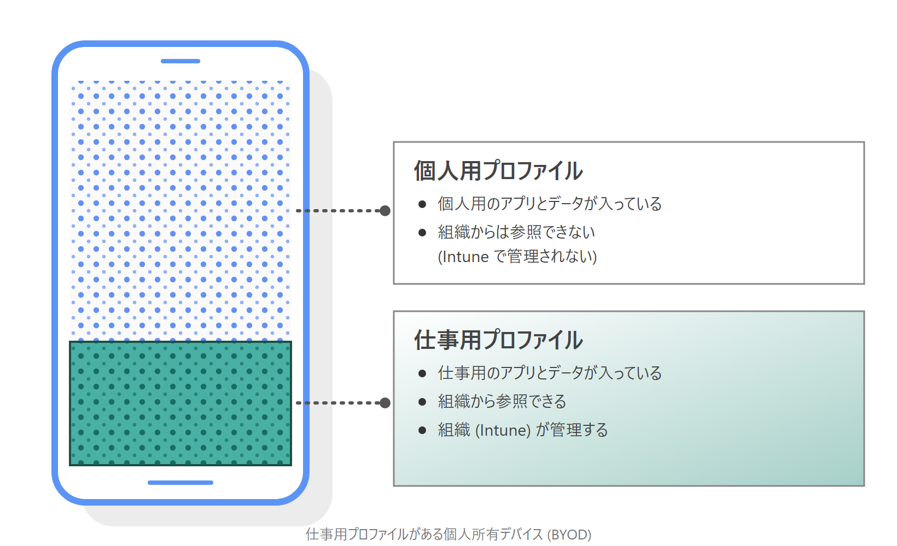
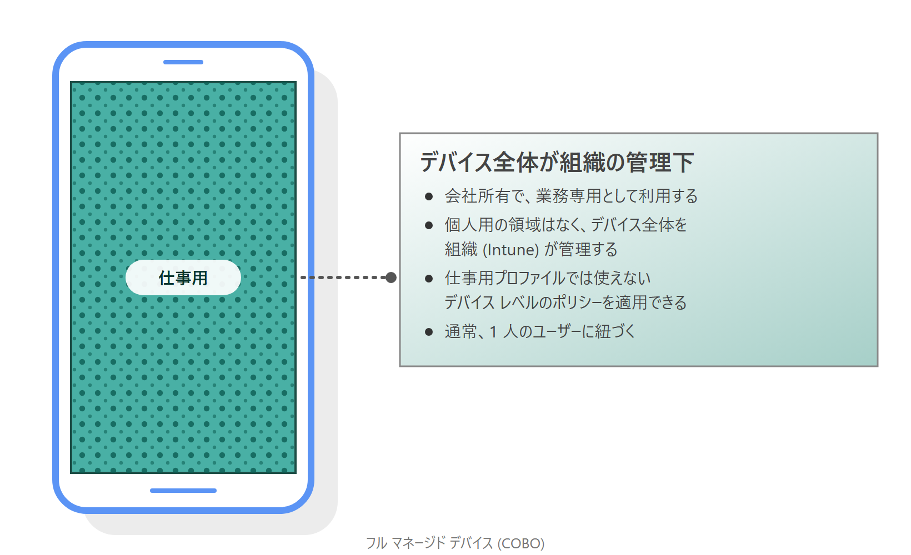
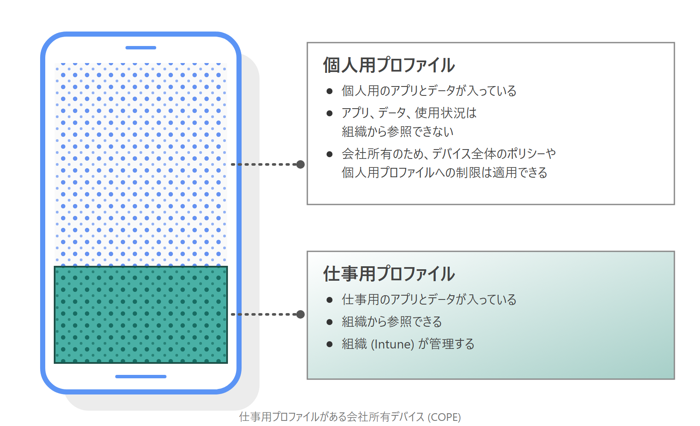
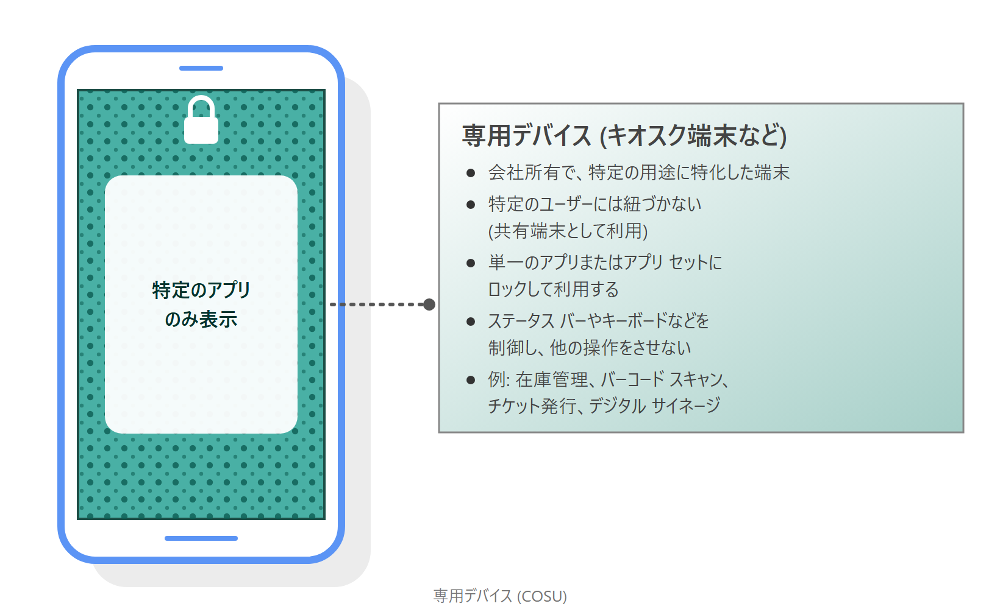
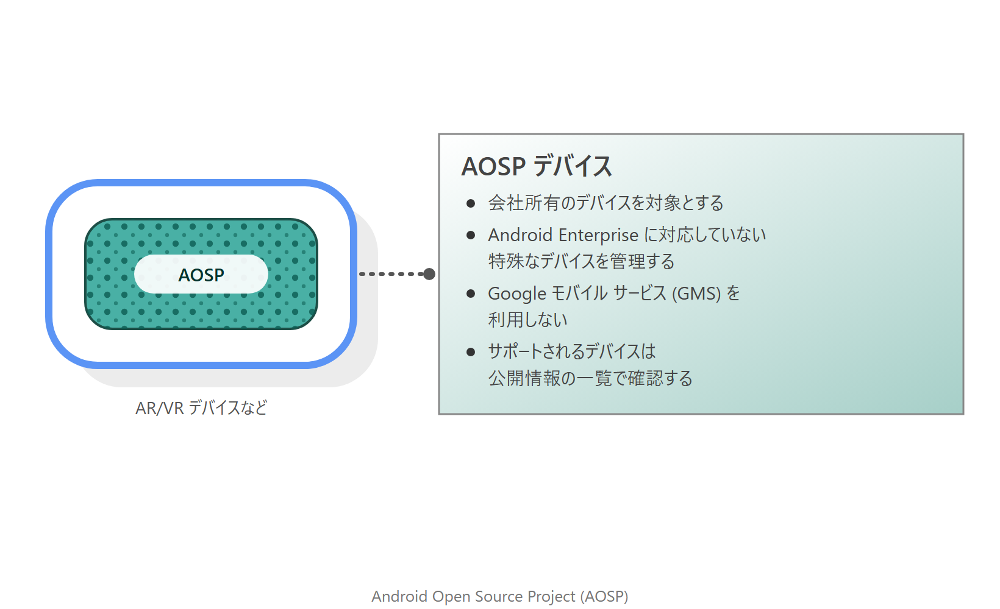

# Intune で Android デバイスを管理する時の登録方法の選び方

みなさま、こんにちは。Intune サポート チームです。

Android デバイスの管理を始める際に、最初に迷われるポイントが「登録方法の選択」です。Android には登録方法が複数あり、さらに Google 社独自の用語 (仕事用プロファイル、フル マネージド 等々) も登場するため、「自社の運用にはどの方法が合うのか」が分かりにくいという声をよくいただきます。

本記事では、Intune で利用できる Android の登録方法を、**個人所有 (BYOD) のデバイス** と **企業所有のデバイス** に分けて整理し、それぞれどのようなケースで利用する方法なのかをご紹介します。あわせて、企業所有のデバイスで、iOS の ADE や Windows の Autopilot のようにキッティングを効率化する方法についてもご紹介します。

なお、Android 固有の仕様については、下記の記事でも紹介していますので、あわせて参考にしてみてください。

- Android デバイスを Intune で管理する際に押さえておきたいポイント | Japan Microsoft Intune Support Team Blog
  https://jpintune.github.io/blog/intune/20260731_03/

---

## 登録方法の全体像

Intune で Android デバイスを管理する登録方法は、大きく下表のとおりです。

| 所有形態 | 登録方法 | 略称 | 主な用途 |
| --- | --- | --- | --- |
| 個人所有 | Android Enterprise 個人所有の仕事用プロファイル | BYOD | 個人所有のスマートフォンで会社のメールやアプリを利用する |
| 企業所有 | Android Enterprise フル マネージド | COBO | 社給のスマートフォンを 1 人 1 台で業務専用として利用する |
| 企業所有 | Android Enterprise 会社所有の仕事用プロファイル | COPE | 社給のスマートフォンで業務と個人利用の領域を分けて利用する |
| 企業所有 | Android Enterprise 専用デバイス | COSU | キオスク端末など、特定の用途に特化した端末として利用する |
| 企業所有 | Android Open Source Project (AOSP) | - | Android Enterprise に対応していない特殊なデバイス (AR/VR デバイス等) を管理する |
| 個人所有 / 企業所有 | Android デバイス管理者 (非推奨) | DA | Google モバイル サービス (GMS) が利用できないデバイス等 |

まずは、**「個人所有か、企業所有か」** で絞り込み、次に「そのデバイスをどのような使い方で運用したいか」で選んでいただくと整理しやすくなります。

- Android デバイスの登録に関する公開情報 (登録ガイド)
  https://learn.microsoft.com/ja-jp/intune/intune-service/fundamentals/deployment-guide-enrollment-android

---

## 個人所有のデバイスの登録 (BYOD)

### Android Enterprise 個人所有の仕事用プロファイル

基本的に BYOD の Android を Intune に登録する場合には、この登録方法を利用していただくことになります。デバイス上に会社用の領域 (仕事用プロファイル) が作成され、会社のデータやアプリは仕事用プロファイルの中で管理されます。個人用の領域は Intune から管理されないため、ユーザーのプライバシーが保たれます。

なお、個人所有の仕事用プロファイルは、Intune が Google 社の Android Management API を利用する方式への移行を進めており、新しいデバイスでは Web ベースの登録フローが利用されるようになります。詳細については、下記の公開情報もあわせてご確認ください。

- 仕事用プロファイルで個人所有のデバイスに Android Management API を使用する
  https://learn.microsoft.com/ja-jp/intune/device-enrollment/android/android-management-api-overview

#### 特定のデバイスのみの登録を許可できる？

運用によっては、BYOD のデバイスであっても、事前に社内で申請を行ったデバイスのみ登録を許可したいというご要望もあると思います。

Android 11 以前では、iOS 等と同様に、下記の公開情報の方法で企業向けデバイスの識別子としてシリアル番号や IMEI を事前に Intune に登録しておくことで、BYOD のデバイスであっても企業所有のデバイスとして認識させることができていました。しかし、**Android 12 以降のバージョンでは、Google 社のセキュリティの強化に伴い、この方法は利用できなくなっています。**

- デバイスの企業所有としての識別
  https://learn.microsoft.com/ja-jp/intune/device-enrollment/add-corporate-identifiers

Android 12 以降のバージョンでも、事前にユーザーから申請があったデバイスのみを利用させたい場合は、登録自体をブロックすることはできません。そのため、次のように「登録はできるが、社内リソースにはアクセスさせない」という構成を取ることをご検討ください。

1. ユーザーから申請があったデバイスのみ、手動でグループに追加し、そのグループにコンプライアンス ポリシーを割り当てる (デバイスは登録後にグループへ追加するため、追加されるまでは一時的に非準拠となります)
2. コンプライアンス ポリシーが割り当てられていないデバイスは「非準拠」として扱われるよう、テナント全体の設定 (**コンプライアンス ポリシーが割り当てられていないデバイスをマークする**) を **非準拠** に構成する
3. 条件付きアクセスで「準拠しているデバイス」を要求する

この構成により、申請なしで登録されたデバイスは非準拠となり、条件付きアクセスによってブロックされるため、社内のリソースにはアクセスできなくなります。

### 非推奨 : Android デバイス管理者登録

この方法は古い登録方法であり、現在は基本的に利用しない非推奨の登録方法です。**Google モバイル サービス (GMS) が利用できるデバイスでは、既にサポートされていない登録方法となっています。** ただし、GMS が利用できない国や、GMS に対応していないデバイスでは、引き続きこの方法を利用して Intune から管理することが可能です。

日本国内でご利用いただく場合には、特に問題になることはありませんが、グローバルにデバイスを展開する場合には、一部の国で Android Enterprise や GMS の利用が制限されている可能性があります。Android Enterprise を利用できる国については、下記の Google 社の公開情報で紹介されていますので、参考にしてみてください。

- Android Enterprise を利用できる国 (Google 社の公開情報)
  https://support.google.com/work/android/answer/6270910

また、一般的に販売されている Android であれば、通常は Android Enterprise や GMS に対応していますが、Android をベースに独自のカスタマイズが行われている OS を搭載した機種では、Android Enterprise や GMS が利用できない可能性があります。対応状況の確認が必要な場合は、端末の開発元に確認するのが確実です。

---

## 企業所有のデバイスの登録

企業所有のデバイスを登録する方法は、デバイスの使い方によって下記から選択します。いずれの方法も、**デバイスの初期状態 (工場出荷時の状態) から登録を開始する必要があります。** すでに利用中のデバイスを登録する場合は、工場出荷時の状態にリセットする必要がある点にご注意ください。

### Android Enterprise フル マネージド (COBO)

一般的に Android の社給デバイスを各ユーザーに配って、スマートフォンとして利用させたい場合は、この登録方法がイメージに近いと思います。デバイス全体が会社の管理下に置かれ、1 人のユーザーが業務専用で利用する形となります。個人用の領域は存在しないため、Intune でデバイス全体を管理できます。

### Android Enterprise の会社所有の仕事用プロファイル (COPE)

この登録方法は、あまり利用されることが多くない方法ですが、企業所有の端末として管理しつつ、端末上で個人利用のための領域も確保するような方法となります。ユーザーの利用イメージ自体は、前述の「Android Enterprise 個人所有の仕事用プロファイル」に近い形となります。

### Android Enterprise 専用デバイス (COSU)

この登録方法は、キオスク端末等、特定の用途や業務に特化した端末を管理する場合に利用します。特定のユーザーには紐づかず、在庫管理、バーコードのスキャン、チケットの印刷など、共有で利用するデバイスに適しています。

### Android Open Source Project (AOSP)

AOSP は、Android Enterprise に対応していない特殊なデバイス (AR/VR デバイス等) を管理する場合に利用する登録方法です。具体的に登録可能なデバイスの一覧については、下記で紹介していますので、参考としてください。

- Android オープン ソース プロジェクトでサポートされているデバイス
  https://learn.microsoft.com/ja-jp/intune/fundamentals/aosp-supported-devices

### どの登録方法を選べばよい？

企業所有のデバイスについては、下記を目安にご検討ください。

| デバイスの使い方 | 一般的な登録方法 |
| --- | --- |
| 1 人 1 台、業務専用で利用する | フル マネージド (COBO) |
| 1 人 1 台、業務と個人利用を 1 台で両立させる | 会社所有の仕事用プロファイル (COPE) |
| ユーザーに紐づかない共有端末、キオスク端末 | 専用デバイス (COSU) |
| AR/VR デバイスなど、Android Enterprise 非対応のデバイス | AOSP |

なお、BYOD のデバイスを企業所有の登録方法で登録することや、企業所有のデバイスを BYOD の登録方法で登録することは一般的ではありません。デバイスの所有形態に合った登録方法を選択してください。

---

## キッティング方法

すでに iOS (ADE) や Windows (Autopilot) を管理しているお客様の中には、Android でも同じように、デバイスを開封して電源を入れるだけで自動的に Intune へ登録される仕組みや、管理者の手間を減らす仕組みを利用したいというご要望があるかと思います。

Android の企業所有のデバイスには、下記のようなキッティング方法が用意されています。

### ゼロタッチ

Google 社のゼロタッチ登録を利用すると、デバイスを初めて起動したときに、自動的に Intune への登録が開始されるようになります。iOS の ADE や Windows の Autopilot に近い仕組みとなります。次の登録方法で利用できます。

- Android Enterprise フル マネージド (COBO)
- Android Enterprise の会社所有の仕事用プロファイル (COPE)
- Android Enterprise 専用デバイス (COSU)

ゼロタッチ登録を利用するには、**ゼロタッチ登録に対応したデバイスを、Google 社が認定したゼロタッチの販売店から購入する**必要があります。そのため、すでに購入済みのデバイスや、販売店以外から購入したデバイスでは利用できません。購入先や必要な準備については、下記の公開情報を参考にしてください。

- Android Enterprise 専用、フル マネージド、または仕事用プロファイルを備えた会社所有のデバイスを登録する
  https://learn.microsoft.com/ja-jp/intune/device-enrollment/android/ref-corporate-methods

Samsung 製のデバイスであれば、Samsung 社の Knox Mobile Enrollment (KME) を利用して、同様にデバイスの登録を自動化することも可能です。

- Samsung の Knox Mobile Enrollment を使用して Android デバイスを自動的に登録する
  https://learn.microsoft.com/ja-jp/intune/device-enrollment/android/setup-samsung-knox-mobile

### QR コード / トークンによる登録

ゼロタッチ登録が利用できないデバイスでは、デバイスを工場出荷時の状態にしたうえで、初期セットアップ画面で QR コードをスキャンする、またはトークンを入力することで、Intune に登録できます。管理者が事前にデバイスの登録を行ってからユーザーに配布することも、ユーザーが自分で登録することも可能です。

なお、Android 11 以降の Android Enterprise の会社所有の仕事用プロファイル (COPE) では、トークンの手動入力による登録はサポートされていません。この場合は、QR コードのスキャンで登録してください。

### デバイスのステージング

ゼロタッチを利用できない環境でも、管理者や委託先のベンダーが事前にデバイスの準備を行い、ユーザーが行う操作を最小限に抑えたいという場合には、デバイスのステージングを利用できます。ステージング用のトークンを使うことで、次のような流れで登録を行います。

1. 管理者が、Intune 管理センターでステージング用のトークンを含む登録プロファイルを作成する
2. 管理者またはベンダーが、デバイスでトークンの QR コードをスキャン (またはトークンを入力。ただし、Android 11 以降の COPE ではトークンの手動入力は不可) し、セットアップ ウィザードを完了させる。この時点では、デバイスはユーザーに紐づいていない
3. デバイスの電源を切り、ユーザーに配布する
4. ユーザーは、デバイスの電源を入れて Microsoft Intune アプリに職場または学校アカウントでサインインするだけで、登録が完了する

デバイスのステージングは、次の登録方法で利用できます。

- Android Enterprise フル マネージド (COBO)
- Android Enterprise の会社所有の仕事用プロファイル (COPE)

専用デバイス (COSU) では利用できませんので、ご注意ください。

- デバイスのステージングの概要
  https://learn.microsoft.com/ja-jp/intune/device-enrollment/android/device-staging

### キッティング方法の比較

| キッティング方法 | COBO | COPE | COSU | 特徴 |
| --- | --- | --- | --- | --- |
| ゼロタッチ | ○ | ○ | ○ | 対応デバイスを認定販売店から購入する必要がある。電源を入れるだけで登録が開始される |
| デバイスのステージング | ○ | ○ | - | 管理者やベンダーが事前に準備し、ユーザーはサインインするだけで登録できる |
| QR コード / トークン | ○ | ○ | ○ | 特別な購入手続きが不要。初期セットアップ時に QR コードのスキャンやトークンの入力が必要 (Android 11 以降の COPE ではトークンの手動入力は不可) |

---

## まとめ

- Android の登録方法は、まず **「個人所有か、企業所有か」** で絞り込み、次に利用イメージで選択する
- BYOD は **Android Enterprise 個人所有の仕事用プロファイル** を利用する。Android 12 以降は、企業向けデバイスの識別子を使って登録を制限することはできない
- Android デバイス管理者は非推奨であり、GMS が利用できるデバイスではサポートされていない
- 企業所有は、利用形態に合わせて **COBO / COPE / COSU / AOSP** から選択する
- キッティングを効率化したい場合は、**ゼロタッチ** や **デバイスのステージング** の利用を検討する。ゼロタッチは認定販売店からの購入が必要となるため、デバイスの調達方法とあわせて検討する

登録方法を決めた後の運用で押さえておきたい Android 固有の仕様については、下記の記事もあわせてご確認ください。

- Android デバイスを Intune で管理する際に押さえておきたいポイント | Japan Microsoft Intune Support Team Blog
  https://jpintune.github.io/blog/intune/20260731_03/

本記事が、Android デバイスの管理を始める際の参考となれば幸いです。
